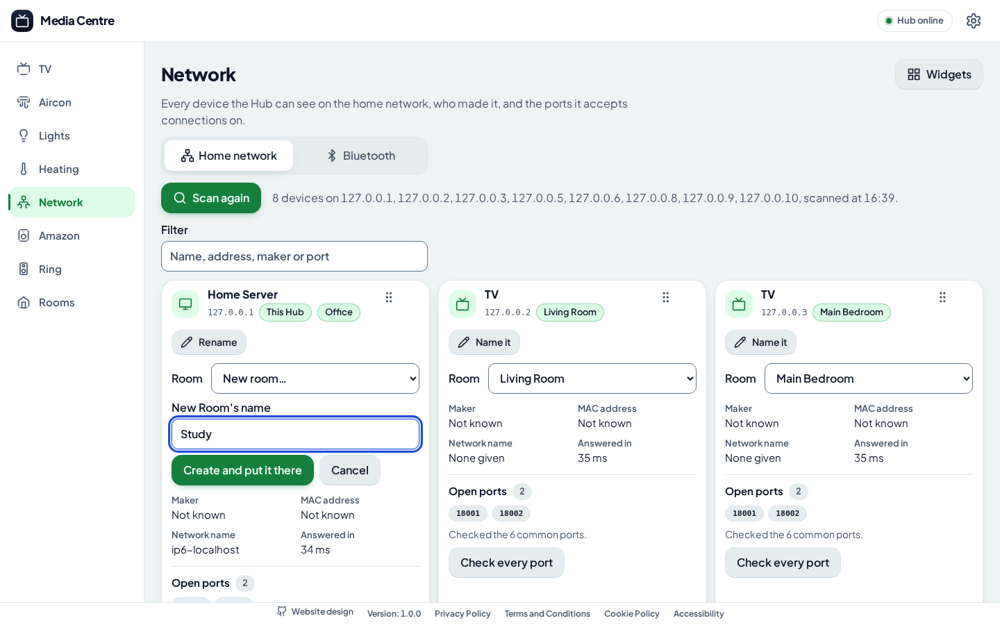
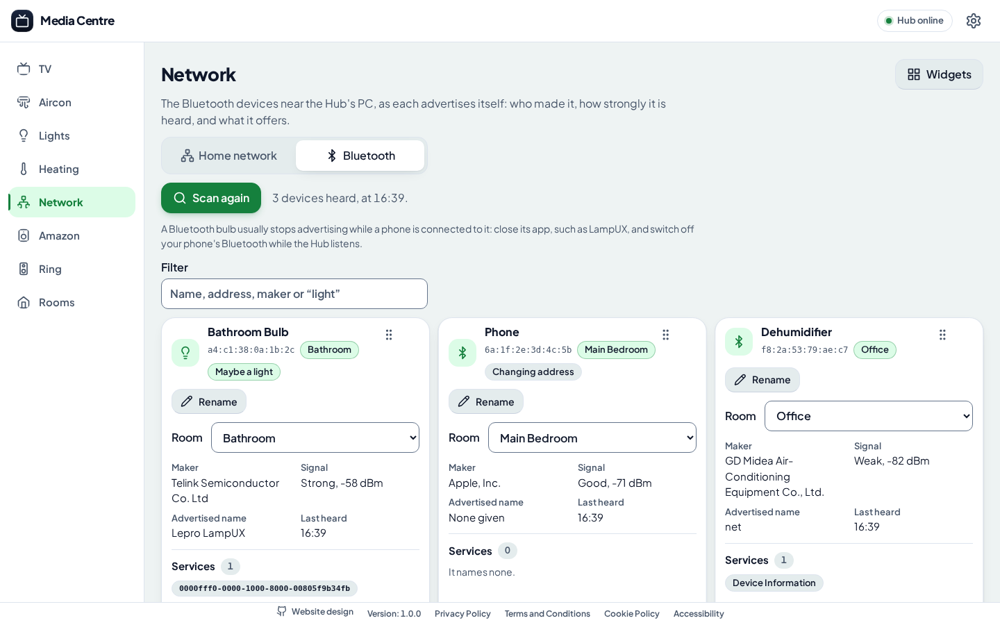

# The Network tab

The Network tab, between the Heating tab and the Amazon tab, shows two things, chosen at its top:

- **Home network:** every device the Hub can see on the home network, who made each one, its addresses and name, the Appliance the Hub has there, and the ports it accepts connections on.
- **Bluetooth:** the Bluetooth devices near the Hub's PC, as each advertises itself.

The requirements are in the [Network PRD](../product-requirements-document/network.md), and why it works as it does in [ADR 0012](../architectural-decision-record/0012-the-network-is-found-by-scanning-it-from-the-hub.md) and [ADR 0013](../architectural-decision-record/0013-bluetooth-is-heard-through-windows-own-api.md).

It helps find a device the Hub should control, such as a Light that "Find Lights" doesn't find, or one that is on the network but shouldn't be. Each Remote remembers which of the two it was left on.

## The last scan, kept

Nothing is scanned until you ask. The tab opens on the last scan of each view, with when it was made, and **Scan again** looks afresh:

- **The Hub keeps the last scan** of the network, and of Bluetooth, in its database, so every Remote sees it, and it survives a restart.
- **Each Remote keeps the last scan it showed**, in its own storage, under `media-centre:network-scan` and `media-centre:bluetooth-scan`, and shows it at once as the tab opens, before the Hub has answered, then what the Hub has.

## Widgets

Each device is a widget, as on the TV, Aircon, Lights and Heating tabs. They start three across on a desktop, two on a tablet and one on a phone. Each can be dragged, resized, hidden and put back through its grip, its grip's menu, arrow keys and the Widgets menu. Each Remote remembers its layout: the home network's under `media-centre:network-widgets`, and Bluetooth's under `media-centre:bluetooth-widgets`.

## Naming a device

"Name it" on a device's widget, then "Rename", names it, so it is called so wherever it shows, on every Remote. Saving an empty name forgets it, and it is called what it was before. A name is at most 40 characters.

The Hub keeps each name in its database, so it survives a restart:

- **A device on the home network** is named by its MAC address, so it keeps its name when the router gives it another IP address. One the Hub has no MAC address for is named by its IP address.
- **A Bluetooth device** is named by its Bluetooth address. A phone or tablet makes up a new one now and then, marked "Changing address", so its name lasts only until it does.

## Putting a device in a Room

Each device's widget has a Room picker, under its name: "No room", each of the Hub's Rooms, in Room order, and "New room…". Choosing a Room puts the device in it, shown as a chip beside its address. "New room…" asks for the new Room's name, then "Create and put it there" makes the Room, as Settings › Rooms would, and puts the device in it. The Hub refuses a name a Room already has, and says why beside the picker.

- **A device that is an Appliance**, such as a TV or an Air Conditioner the Hub has, is moved to the Room, as Settings moves it, so it moves on every tab. The Hub refuses the move as Settings would, e.g. where the Room already has an Appliance of its kind with the same name.
- **Any other device**, on the home network or Bluetooth, is kept in the Room in the Hub's database, by its MAC address, IP address or Bluetooth address, as its name is. It stays there through a restart, and goes back to "No room" if the Room is deleted.

Each Room on the [Rooms tab](rooms-and-floor-plan.md#a-rooms-devices) lists the devices put in it, though not the Appliances, which it shows as it always has.

## Scanning the home network

"Scan the network", and then "Scan again", has the Hub scan its own /24 subnet, e.g. `192.168.1.0/24` when its address is `192.168.1.10`. The scan takes about 15 seconds, while the tab shows how many addresses the Hub has looked at.

1. **Finding devices.** The Hub tries a few TCP ports at every address of the subnet: 80, 443, 22, 445, 139, 135, 554, 7000, 8008, 8080 and 62078. A device that accepts a connection on any of them is there, and so is one that refuses: only an address with nothing at it says nothing at all.
2. **Its ARP table.** The Hub adds every address on the subnet that its machine's ARP table has a MAC address for. Trying those ports makes the machine ask each address for its MAC address, so this finds devices that accept and refuse nothing, such as a Hive hub.
3. **Each device's ports and name.** For each device found, the Hub tries the 46 common ports a home's devices are known by, from a NAS's to a TV's, an Air Conditioner's and a Tuya module's, and every port found open on it before by checking every port. It also asks the network's DNS for the device's name.

### Checking every port

"Check every port" on a device's widget tries all 65,535 ports of that device, showing how far it has got. A device that drops what it doesn't accept, rather than refusing it, takes a minute or two.

The Hub remembers the ports it finds open, in its database, by the device's MAC address as for its name. Every scan after tries them too, so they show each time without checking every port again. The widget says how many it tried that way, e.g. "Checked the 46 common ports, and 2 ports found open before".

The Hub keeps the last scan only while it runs, and logs each scan, and each check of every port, as it starts and ends.

### What each device shows

- **Its name.** What it was named, otherwise the Appliance's name if the Hub has an Appliance at its address, with its Room, otherwise the name DNS gives it. If DNS gives none, it shows who made it. The Hub's own machine is marked "This Hub".
- **Maker.** Who made the device's network card, from its MAC address, looked up in the IEEE's registry, which the Hub has with it (`oui-data`), so it works offline. A phone or tablet usually makes up a private MAC address for each Wi-Fi network, which says nothing of who made it, so its maker shows as not known.
- **MAC address.** As the Hub's machine's ARP table has it.
- **Network name.** As the network's DNS gives it. A name that is only the address written out, as a VPN's DNS gives every address, is left out.
- **Answered in.** How quickly the device answered the Hub. "Only to the Hub's ARP" means it accepted and refused nothing, and was found only by its MAC address.
- **Open ports.** Each port the device accepted a connection on, with what usually listens there, and whether the common ports or every port were checked.

The filter above the devices matches any of these, e.g. a maker's name, a port number or a service.

## Listening for Bluetooth devices

"Scan for Bluetooth devices", and then "Scan again", has the Hub listen for 20 seconds for the Bluetooth Low Energy advertisements each device near its PC sends every second or so. The widgets fill in as it hears them.

Each device shows what it was named, otherwise the name it advertises, otherwise its maker, with:

- **Maker.** The company its advertisement names, by the Bluetooth SIG's list of company ids. For a device with its maker's own address that names no company, it shows the IEEE's registry entry instead.
- **Signal.** How strongly the Hub heard it at best, in dBm, and in a word: strong from -60, good from -75, weak from -85, and very weak below.
- **Advertised name** and **Last heard.**
- **Services.** The services it names, by the Bluetooth SIG's name where it assigned one, otherwise by UUID.
- **"Maybe a light".** Shown when its name sounds like a light's (Lepro, LampUX, bulb, lamp, light, LED or strip) or its maker is Tuya or Telink, who make the chips in many smart bulbs. Such devices are listed first, then the rest by signal. "light" in the filter shows only these.

A Bluetooth bulb usually stops advertising while a phone is connected to it. Close its app, such as LampUX, and switch off the phone's Bluetooth while the Hub listens.

The Bluetooth view only finds devices. The Hub can't control a Bluetooth bulb yet: that needs its protocol, which this is the first step to finding.

### How the Hub listens

The Hub listens with Windows' own Bluetooth API, so only a Hub running on Windows can, and only on a PC with Bluetooth switched on. Elsewhere, the view says so and its button is disabled.

The Hub needs nothing installed for it. The first time it listens, it compiles its helper, `packages/hub/src/bluetooth/ble-watch.cs`, with the C# compiler that comes with Windows, from .NET Framework 4, into the system's temporary folder. It then runs the helper for each scan. The helper writes each advertisement it hears as a line, which the Hub reads as the helper writes it. If Windows stops it, as when Bluetooth is switched off, the view says why.

The makers' and services' names are in `packages/hub/src/bluetooth/assigned-numbers.json`, generated from the Bluetooth SIG's assigned numbers by `node scripts/bluetooth-assigned-numbers.ts`. Run it again to take in what the SIG has added since.

## What it can't see

- **Devices on another network.** A guest or IoT Wi-Fi network that the router keeps apart from the Hub's can't be seen on the home network, though a device near the Hub's PC that advertises over Bluetooth can.
- **The Hub in Docker.** It sees the home network only with host networking, as [Running the Hub in Docker](../setup/running-the-hub-in-docker.md) says. On Docker's default bridge network, it scans the container's own subnet. It can't listen for Bluetooth devices there at all.
- **UDP-only devices.** A device that accepts no TCP connection, refuses none and isn't in the ARP table isn't found.
- **Classic Bluetooth devices.** Only Bluetooth Low Energy devices advertise, so a device that uses only classic Bluetooth, such as an older speaker, isn't heard.

## The API

- `GET /api/network` answers with the last scan, or the one under way, as a `NetworkScan`.
- `POST /api/network/scan` starts a scan, unless one is under way, and answers at once.
- `POST /api/network/devices/<address>/ports` starts checking every port of a device found, and answers at once.
- `PUT /api/network/devices/<address>/name` with `{ "name": "…" }`, or `null`, names a device found, or forgets its name.
- `PUT /api/network/devices/<address>/room` with `{ "roomId": 3 }`, or `null` for "No room", puts a device found in a Room, moving it if it is an Appliance.
- `GET /api/network/rooms` answers with every device in a Room, but Appliances, as `RoomDevices`, for the Rooms tab: what each was named or last seen as, its address and its maker.
- `GET /api/network/bluetooth` answers with the last Bluetooth scan, or the one under way, as a `BluetoothScan`.
- `POST /api/network/bluetooth/scan` starts listening, unless the Hub is, and answers at once.
- `PUT /api/network/bluetooth/devices/<address>/name` names a Bluetooth device heard, as above.
- `PUT /api/network/bluetooth/devices/<address>/room` puts a Bluetooth device heard in a Room, as above.

The Remote asks again every second while a scan, a check or a Bluetooth scan is under way.

## Testing against fakes

- `NETWORK_SCAN_TARGETS` gives the addresses to scan, separated by commas, in place of the Hub's subnet, and `NETWORK_SCAN_PORTS` the ports to try. The end-to-end tests set them to the fake TVs' addresses and REST port, so the tests never scan the real network.
- `BLUETOOTH_HELPER` runs a program, or a Node script, in place of the Hub's own Bluetooth helper, on any machine, and `BLUETOOTH_SCAN_SECONDS` sets how long a scan listens. The end-to-end tests run the fake helper, `packages/hub/src/fakes/bluetooth/fake-ble-watch.ts`, which writes the lines the real one does for three devices: a Lepro Light with a Telink chip, a phone with a changing address, and a Midea Air Conditioner.
