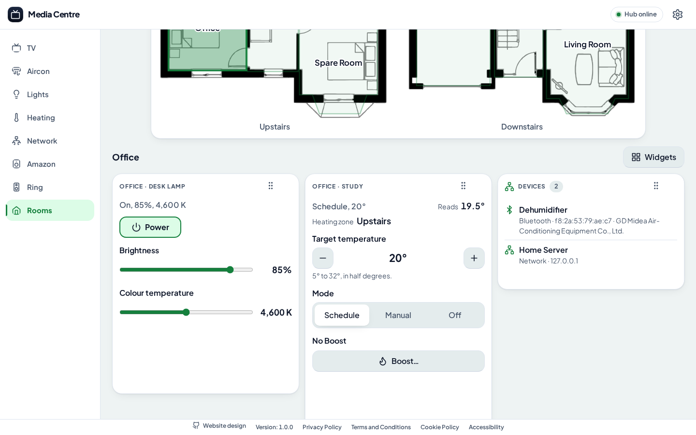

# Rooms and the floor plan

The Rooms tab shows the home's floor plan and everything in one Room: its TVs, Air Conditioners, Lights and Heating, its Echos and Ring devices, and the other devices on the network or Bluetooth put in it.

## The Rooms tab

The requirements are in the [Rooms PRD](../product-requirements-document/rooms.md).

The Rooms tab, always the last tab, after the Ring tab, shows the home's floor plan, the built-in drawing [`packages/remote/public/images/floor-plan.svg`](../../packages/remote/public/images/floor-plan.svg) until one is drawn (see [Drawing the floor plan](#drawing-the-floor-plan)), a floor at a time, side by side on a wide screen and one above the other on a phone, and every Appliance in one Room, chosen by tapping it on the plan or from a list of the Rooms, in Room order, with "No room" last where any Appliance has none. Each Remote remembers the Room it last showed, under `media-centre:rooms-tab-room`.

## A Room's widgets

Under the floor plan, the Room chosen is a board of widgets, as the other tabs are: each dragged by its grip, or, with a mouse, by any part of it that isn't a control, resized from its corner, and moved, resized or hidden from its grip's menu or keys; the **Widgets** menu shows or hides each one, and puts every one back where it started. Each Room has a board of its own, and each Remote remembers each Room's, under `media-centre:rooms-widgets:<Room id>`, or `media-centre:rooms-widgets:none` for "No room".

## A Room's Appliances

Each of its Appliances is a widget, in the order of the tabs:

- each TV, with whether it is on, its Power button, and "Open in the TV tab", which opens the TV tab on it;
- each Air Conditioner and Light, with every control it has in its own tab;
- and, in one widget, Heating, each of Hive's, a Heating, a Radiator Valve or the Hot Water, with every control it has in the Heating tab, and, in a Room with more than one Radiator Valve, its Room-wide target, Hive read for them every 30 seconds while a Room with any is shown, as the Heating tab reads it.

## A Room's devices

Beside its Appliances, a Room shows every other device put in it:

- as a widget each, each Echo put in it from the [Amazon tab](amazon.md), and each Ring doorbell, camera and chime put in it from the [Ring tab](ring.md), with every control it has on its own tab, read from Amazon or Ring every 5 seconds while it is shown, while the Hub is signed in to them;
- and, in a widget called "Devices", every device put in it from the [Network tab](network.md#putting-a-device-in-a-room), on the home network or Bluetooth, but for Appliances, which it shows as above, and an Echo or Ring device while the Hub is signed out of its account. Each is listed by its name, or what a scan last saw it as, with whether it is on the network, Bluetooth, Amazon or Ring, its address and its maker. The Hub keeps these, so a Room lists them whether or not the Network tab has scanned since. A Room with devices but no Appliances shows its devices, rather than saying it has nothing in it.

## Naming places on the floor plan

Each place on the plan, an outline with an id such as `upstairs-1` and no name, starts as no Room: tapped, it asks which Room it is, one the Hub has or a new one, named there, which the Hub adds. "Edit floor plan" changes which Room a place is, or takes it off the plan.

The Hub keeps which Room each place is, so that every Remote shows the same:

| Request                                                  | What it does                |
| -------------------------------------------------------- | --------------------------- |
| `GET /api/rooms/floor-plan`                              | Which Room each place is    |
| `PUT /api/rooms/floor-plan/<place>` with `{"roomId": 1}` | Makes the place that Room   |
| `DELETE /api/rooms/floor-plan/<place>`                   | Takes its Room off the plan |

A Room is in one place at most, and goes from the plan as it is deleted. With no Rooms, the plan is there to name them on, and Settings to add them.

## Drawing the floor plan

The built-in drawing is one home's. "Draw the plan", in Settings › Rooms › Floor plan and under "Edit floor plan" on the Rooms tab, opens the editor, where the plan is drawn on your own image of the home, or on the built-in drawing:

- **Image**: an SVG, PNG, JPEG or WebP, up to 8 MB. A new image starts the plan over, one floor the whole of it, named "Home".
- **Floors**: each the part of the drawing that floor is, drawn as a rectangle with the Floor tool, and named in the list. With one floor, the whole drawing is shown; with more, each on its own, as the built-in plan's Upstairs and Downstairs are.
- **Places**: each room's outline, drawn as a **Rectangle**, dragged across it or tapped at two opposite corners; a **Shape**, tapped corner by corner and closed at its first corner or with "Finish shape"; or **Draw**n round by hand in one line, which is closed and tidied to its corners as the pointer is let go. A place is on the floor its first corner is on, and is listed by the Room it is, once it is one, or as "Place 1", "Place 2" and so on.

- **Changing a place**: with Select, tap a place to choose it. Drag a corner to move it, or the dot in the middle of an edge to add a corner there; tap a corner instead to pick it, then tap where it goes, or "Remove corner". "Redraw" draws the place again with any tool, and it keeps its id and so its Room.

Undo goes back a step at a time; Escape lets go of a shape half drawn. Nothing reaches the Hub until Save, which sends the image, if a new one, then the layout. A place deleted takes its Room off the plan. "Use the built-in drawing" in the editor, or "Use the built-in plan" in Settings, goes back to the built-in drawing with its own places.

The Hub keeps the drawing, so that every Remote shows the same:

| Request                                                      | What it does                                                                  |
| ------------------------------------------------------------ | ----------------------------------------------------------------------------- |
| `GET /api/rooms/floor-plan-drawing`                          | The layout and the image's type and version, each `null` for the built-in one |
| `PUT /api/rooms/floor-plan-drawing` with the layout          | Makes it the plan's, taking off the plan every place no longer on it          |
| `DELETE /api/rooms/floor-plan-drawing`                       | Goes back to the built-in drawing, image and layout both                      |
| `GET /api/rooms/floor-plan-image`                            | The image, as it was given, sandboxed so an SVG's script never runs           |
| `PUT /api/rooms/floor-plan-image` with the image as its type | Makes it the plan's image, one version on                                     |

A layout is the drawing's width and height, in its own units, and its floors, each with a name of up to 40 characters, the part of the drawing it is as an SVG viewBox, and its places, each an id such as `place-3` and its outline as an SVG polygon's points, 3 to 400 corners. A plan has at most 12 floors and 200 places.
